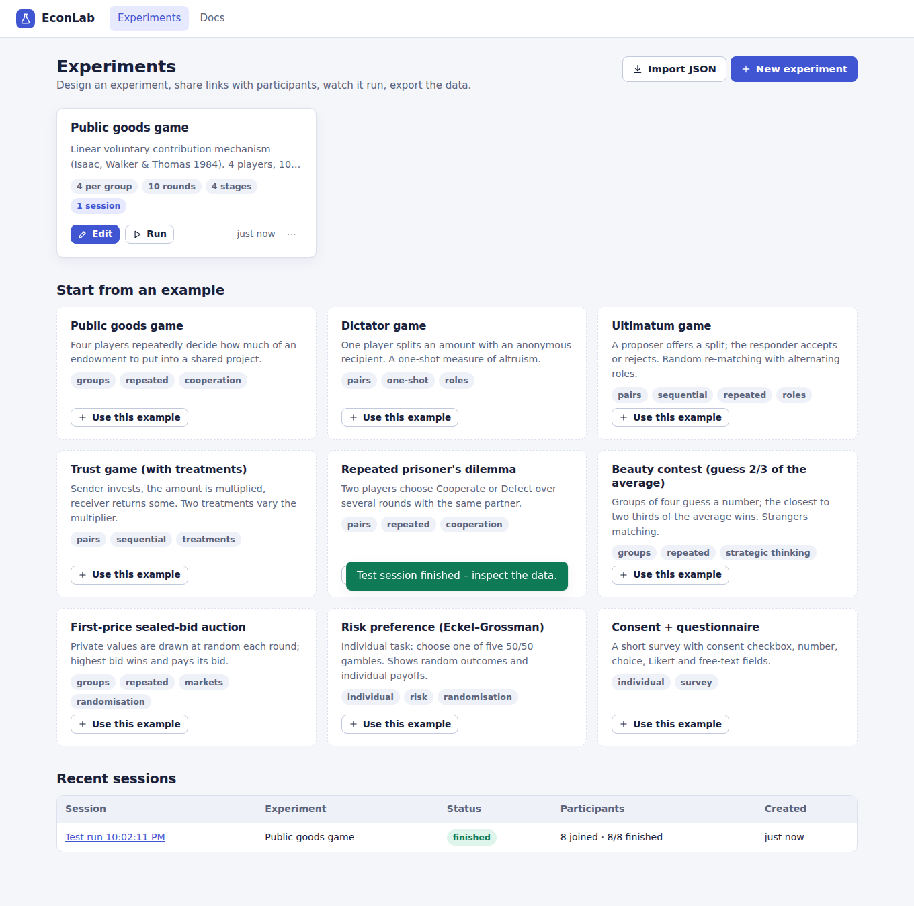
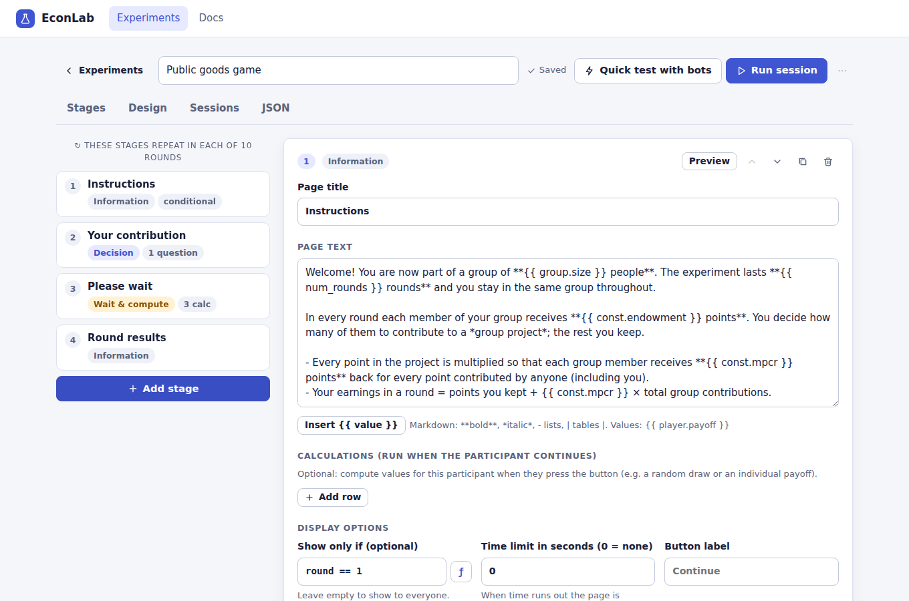
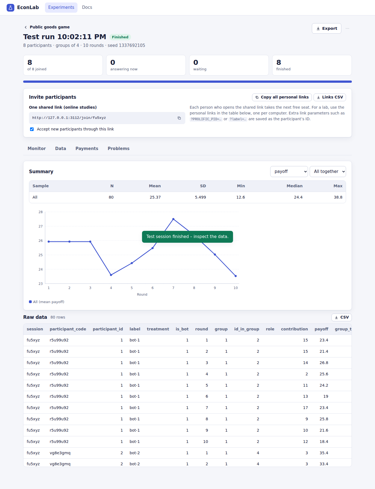
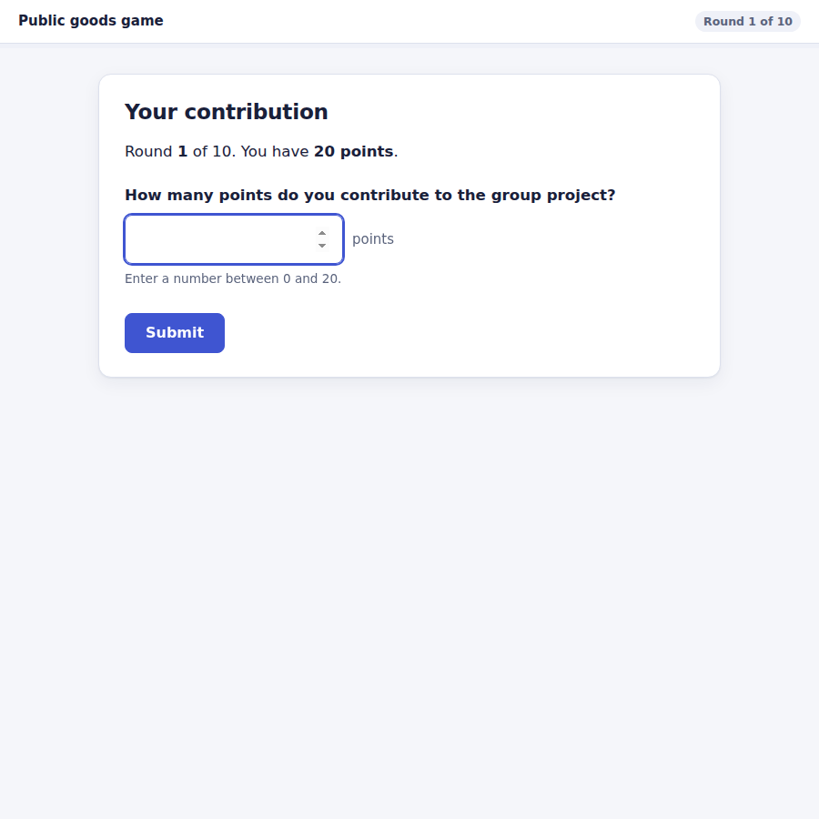
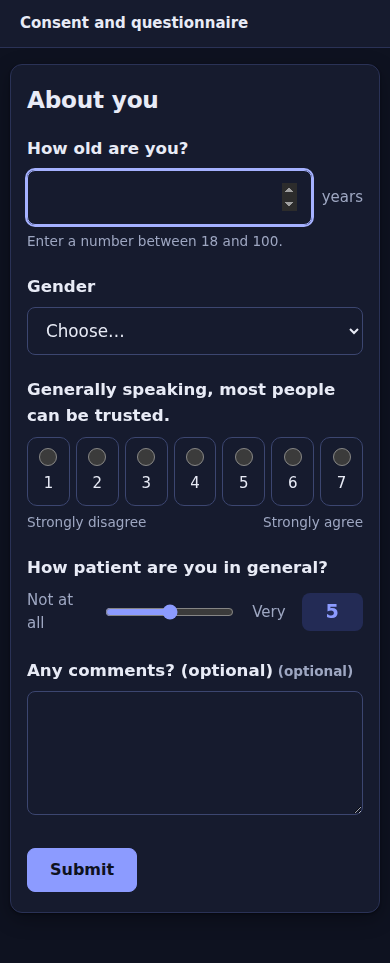

# EconLab

Design and run behavioural and experimental-economics experiments in the browser — an [oTree](https://www.otree.org)-style platform with a **visual builder** instead of Python code.

Researchers build an experiment from stages (instructions, decisions, wait-and-compute pages), describe payoffs with short formulas, share a link, watch participants live, and export data and payments. Participants need nothing but a browser.



## Quick start

Requires **Node.js 20+**. There is nothing to install: no dependencies, no build step, no database server. It runs offline, which matters in lab networks.

```bash
cd econlab
node server/index.js          # → http://localhost:3000
```

1. Click **Use this example** on *Public goods game* (or **New experiment**).
2. Press **Quick test with bots**: a full session runs with simulated participants and opens the data.
3. Press **Run session**, share the links, press **Start session**, and watch the **Monitor**.
4. **Export** data, page times and payments as CSV.

## Features

| | |
|---|---|
| **Visual builder** | Stage list, per-question editors, live formula validation, participant preview, autosave. A JSON tab exposes the complete definition for version control and sharing. |
| **Games with interaction** | Groups of any size, **partners or strangers** matching, **roles** (fixed or rotating), sequential moves, **wait pages** that synchronise a group or the whole session before computing results. |
| **Treatments** | Between-subject treatments override named constants; whole groups are assigned in balanced random blocks. |
| **Payoff language** | A small, sandboxed formula language (`sum(group.players.contribution)`, `if(...)`, `roles.Proposer.offer`, `randint`, `prev.payoff` …). No `eval`: a design from a colleague can never run code on your server. |
| **Question types** | Whole/decimal numbers (bounds may be formulas), sliders, choice (radio/dropdown), Likert, checkbox/consent, short and long text, plus answer checks (comprehension questions, cross-field constraints). |
| **Payments** | Points → currency, participation fee, pay all rounds / one random round / last round. |
| **Running sessions** | Lobby + manual start, personal links for a lab, a **shared join link** for online studies (`?PROLIFIC_PID=…` is stored as the ID), live monitor over server-sent events, **time limits enforced by the server**, “advance” for dropouts, redirect URL after finishing (Qualtrics/Prolific). |
| **Testing** | **Bots** play whole sessions randomly; mix bots with a real seat to try the participant view. Formula errors are collected on a *Problems* tab. A session can be reproduced from its **seed**. |
| **Data** | CSV (one row per participant × round), page times, payments, and a full JSON archive. Summary statistics and charts in the browser. Spreadsheet-formula injection from free text is neutralised. |
| **Classic examples** | Public goods, dictator, ultimatum (rotating roles, strangers), trust (treatments), repeated prisoner's dilemma, beauty contest, first-price auction (random private values), Eckel–Grossman risk task, consent + questionnaire. |



## How an experiment is described

A public goods game, as it appears in the JSON tab (abridged):

```jsonc
{
  "name": "Public goods game",
  "design": {
    "groupSize": 4, "rounds": 10, "matching": "fixed",
    "constants": { "endowment": 20, "mpcr": 0.4 },
    "payment": { "mode": "all", "exchangeRate": 0.05, "participationFee": 5 }
  },
  "stages": [
    { "type": "info", "title": "Instructions", "showIf": "round == 1", "body": "…{{ const.endowment }}…" },
    { "type": "decision", "title": "Your contribution",
      "fields": [{ "name": "contribution", "type": "integer", "min": 0, "max": "const.endowment" }] },
    { "type": "wait", "title": "Please wait",
      "compute": [
        { "scope": "group",  "name": "total",  "expr": "sum(group.players.contribution)" },
        { "scope": "group",  "name": "share",  "expr": "group.total * const.mpcr" },
        { "scope": "player", "name": "payoff", "expr": "const.endowment - player.contribution + group.share" }
      ] },
    { "type": "info", "title": "Round results", "body": "You earned **{{ player.payoff }}** points." }
  ]
}
```

**Synchronisation.** In group experiments all members of a group automatically wait for each other at the start of every round. A *wait & compute* page holds everyone until the whole group (or session) has arrived and then runs its calculations once, so every player's answers are available. Rows run top to bottom; a `player` row runs for every player, a `group` row once per group.

The in-app **Docs** page covers variables, every built-in function, worked examples, and a mapping from oTree concepts.



## Running a session

- **Lab:** open one *personal link* per computer (Monitor tab → *Copy all personal links* or *Links CSV*), let participants arrive, press **Start session**.
- **Online:** share the single *join link*. Each person takes the next free seat. Set **Redirect after finishing** (Design → Messages) to send people back to Qualtrics or Prolific.
- A participant who reloads or loses connection returns to the same page. If someone drops out, **Advance** submits default values (flagged `auto_filled_stages` in the data) so the group can continue; with time limits this happens automatically.

<p>
  
  
</p>

## Hosting

```bash
ADMIN_PASSWORD='a-long-password' HOST=0.0.0.0 PORT=3000 node server/index.js
```

| Variable | Default | |
|---|---|---|
| `PORT` | `3000` | |
| `HOST` | `127.0.0.1` | Use `0.0.0.0` to accept other machines. |
| `DATA_DIR` | `./data` | `db.json` plus a rolling `db.json.bak`. Back this folder up. |
| `ADMIN_PASSWORD` | – | Protects the researcher interface. **The server refuses to listen on a non-local address without it** (override: `ALLOW_OPEN_ADMIN=1`). |
| `TRUST_PROXY` | off | `1` behind a reverse proxy, so login rate limiting sees real client addresses. |

For internet use put it behind an HTTPS reverse proxy (Caddy, nginx); forward `X-Forwarded-Proto` so cookies get the `Secure` flag. Participants only ever receive their own random link; they cannot reach the researcher interface.

State lives in memory and is written atomically to `db.json` (batched, at most every ~0.7 s). Restarting the server keeps all sessions; at worst the last fraction of a second of answers has to be re-entered.

## Data

`<session>_data.csv` has one row per participant and round: session, participant code/id/label, treatment, round, group, id_in_group, role, every question and computed player variable, `payoff`, `group_*` and `session_*` variables, `round_is_paid`, `auto_filled_stages`. Booleans are `1/0`. Text cells starting with `= + - @` get a leading apostrophe so spreadsheets do not execute them. `times.csv` has per-page durations; `payments.csv` has points, exchange rate, earnings, fee and total.

## Tests

```bash
npm test          # 48 unit + HTTP integration tests (node:test, no dependencies)
npm run e2e       # optional browser tests; needs: npm i -D playwright && npx playwright install chromium
```

The suite covers the expression language and its sandbox, matching/roles/treatments, barrier and wait-page synchronisation, validation and stale submissions, timeouts, force-advance, bots, all bundled examples, exports, auth, CSRF, path traversal, SSE, and persistence across restarts. The browser tests drive the shared-link → lobby → start → timeout → payment flow in real Chromium and exercise the editor.

## Project layout

```
server/   index.js (entry) · app.js (REST + SSE) · engine.js (session state machine)
          exporter.js · store.js · examples.js · http.js · rng.js
shared/   expr.js (formula language) · experiment.js (schema, validation)  ← also loaded by the browser
public/   index.html + js/{admin,editor,session,docs,ui,dom,api,markdown}.js   (researcher app)
          play.html  + js/play.js                                               (participant app)
test/     *.test.js  e2e*.mjs
```

## Limitations (v0.1)

- **Scale:** designed for lab and typical online sessions (tens to a few hundred participants). It has been tested on localhost only and has not been load-tested. One Node process, in-memory state, JSON-file persistence.
- **No custom page code:** pages are Markdown plus the built-in question types. There are no arbitrary HTML/JavaScript pages, chat, continuous-time (“live”) pages or drag-and-drop widgets yet. Multiple-price-list / matrix questions are not built in.
- **One researcher account** (shared password). No per-user projects or roles, and no protection against two people editing the same experiment at once (the last save wins).
- **Formulas are single expressions** (no loops or user functions); sequential logic is expressed with ordered calculation rows.
- Participant endpoints are not rate limited; run on a trusted network or behind a reverse proxy that does.
- Stages are reordered with up/down buttons (no drag and drop yet).

## Licence

No licence has been chosen yet. Add one before sharing the code publicly.
